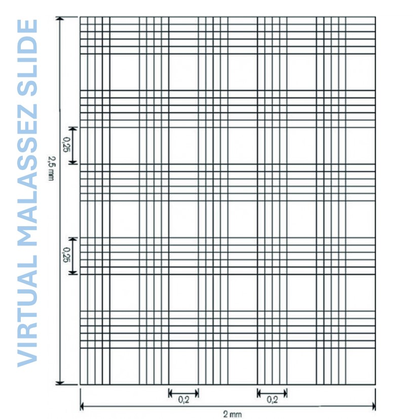

#  MalassezAcademy
  

  

---

## 🔬 What is this?

MalassezAcademy is an **online game that teaches students how to count cells on a Malassez counting chamber** — the 10×10 grid used under the microscope in biology labs.

🎮 **[Play the game](https://fycodelab.github.io/MalassezAcademy/play)** — count the cells, estimate the concentration, beat your score.

---

## 🖼️ Assets

- `assets/game-screenshot.jpg` — the game in action
- `assets/malassez-grid.jpg` — the Malassez grid diagram
- `assets/MAL5.gif` — loading the chamber, in action
